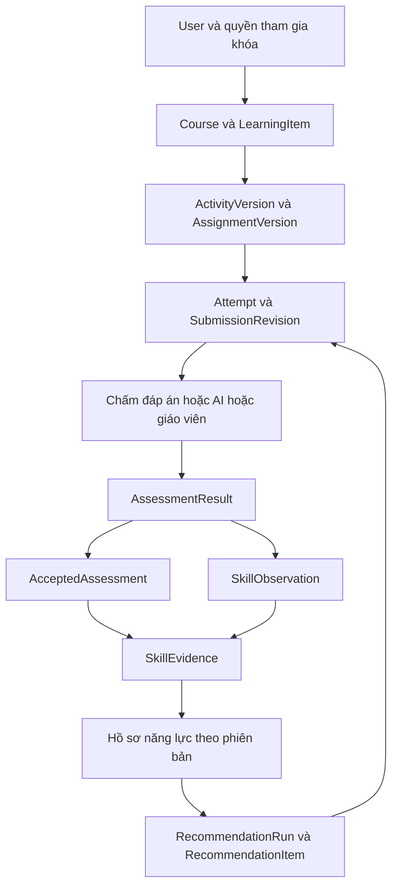
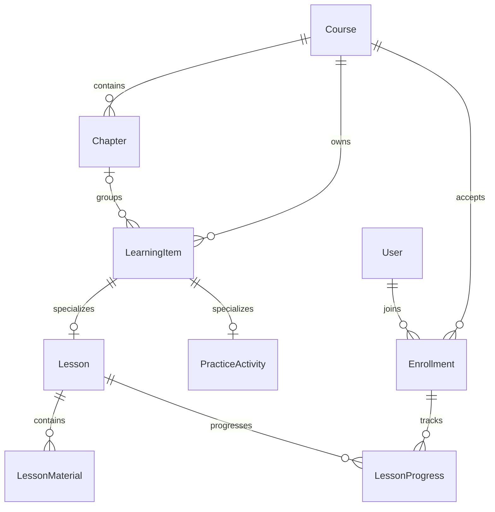

# Mô tả nghiệp vụ database — IELTS Evaluator Pro

Ngày đối chiếu: **24/10/2026**. Phạm vi: **73 bảng** trong [`schema.prisma`](../backend/prisma/schema.prisma), bao gồm 5 bảng RAG mở rộng.

Tài liệu giải thích dữ liệu được tạo để phục vụ việc gì, các bảng liên hệ với nhau thế nào và mỗi luồng nghiệp vụ đọc/ghi những dữ liệu nào. Đây là mô tả thiết kế theo schema hiện tại; không có nghĩa mọi API, worker hoặc quy tắc bên dưới đã được lập trình xong.

Nguồn đối chiếu:

- [`schema.prisma`](../backend/prisma/schema.prisma): model, trường, enum, khóa chính, unique và khóa ngoại.
- [`constraints.sql`](../backend/prisma/constraints.sql): các CHECK, partial unique index và trigger bổ sung dự kiến.
- [`SCHEMA_NOTES.md`](../backend/prisma/SCHEMA_NOTES.md): giới hạn của schema và trách nhiệm service/worker.
- Các ví dụ nghiệp vụ Reading, Writing, appeal, profile và recommendation đã trao đổi: dùng để diễn giải quan hệ; ID, điểm, phản hồi và tài nguyên minh họa không phải kết quả thực nghiệm.
- [`seed.ts`](../backend/prisma/seed.ts): bộ khởi tạo nhỏ gồm tài khoản, khóa học, đề Reading, đáp án, bài giao và rubric demo.

## Mục lục

1. [Mục tiêu và quy ước đọc](#1-mục-tiêu-và-quy-ước-đọc)
2. [Bức tranh dữ liệu toàn hệ thống](#2-bức-tranh-dữ-liệu-toàn-hệ-thống)
3. [Tài khoản, phân quyền và tệp](#3-tài-khoản-phân-quyền-và-tệp)
4. [Khóa học, nội dung và tiến độ](#4-khóa-học-nội-dung-và-tiến-độ)
5. [Đề, bài giao, lượt làm và câu trả lời](#5-đề-bài-giao-lượt-làm-và-câu-trả-lời)
6. [Rubric, AI và kết quả chấm](#6-rubric-ai-và-kết-quả-chấm)
7. [Giáo viên duyệt, công bố và yêu cầu xem lại](#7-giáo-viên-duyệt-công-bố-và-yêu-cầu-xem-lại)
8. [Kỹ năng và bằng chứng](#8-kỹ-năng-và-bằng-chứng)
9. [Hồ sơ năng lực](#9-hồ-sơ-năng-lực)
10. [Gợi ý học tập](#10-gợi-ý-học-tập)
11. [Thảo luận, thông báo, kiểm duyệt và sự kiện](#11-thảo-luận-thông-báo-kiểm-duyệt-và-sự-kiện)
12. [RAG và giải thích có nguồn](#12-rag-và-giải-thích-có-nguồn)
13. [Trạng thái và ranh giới transaction](#13-trạng-thái-và-ranh-giới-transaction)
14. [Quy tắc toàn vẹn và giới hạn hiện tại](#14-quy-tắc-toàn-vẹn-và-giới-hạn-hiện-tại)
15. [Các đường truy xuất nghiệp vụ thường gặp](#15-các-đường-truy-xuất-nghiệp-vụ-thường-gặp)
16. [Phạm vi seed và bộ sample](#16-phạm-vi-seed-và-bộ-sample)

## 1. Mục tiêu và quy ước đọc

### 1.1 Database phải trả lời được những câu hỏi nào?

1. Ai là học viên, giáo viên hoặc quản trị viên? Người đó có quyền gì trong từng khóa học?
2. Khóa học có những bài học, học liệu và bài luyện nào? Học viên đã học đến đâu?
3. Học viên đã làm phiên bản đề nào, dưới điều kiện giao bài nào và đã nộp nội dung gì?
4. Kết quả đến từ AI, giáo viên hay đáp án? Đã dùng rubric, prompt và cấu hình nào?
5. Kết quả nào được chấp nhận và đã công bố? Có bị thay thế sau yêu cầu xem lại không?
6. Kỹ năng được nhận xét dựa trên những bài làm nào? Nguồn nào đủ điều kiện tính hồ sơ?
7. Vì sao hệ thống đề xuất một bài học hoặc bài luyện? Học viên có bắt đầu làm từ gợi ý đó không?
8. Nhận xét dựa trên đoạn nào trong bài viết, và phần giải thích tham khảo tài liệu nào?

### 1.2 Cách đọc quan hệ

- **PK — khóa chính:** định danh một bản ghi. Phần lớn là UUID; một số bảng nối dùng khóa ghép.
- **FK — khóa ngoại:** một hoặc nhiều cột trỏ tới khóa của bảng khác.
- **1–N:** một bản ghi phía đầu có thể được nhiều bản ghi phía sau tham chiếu.
- **N–N:** quan hệ nhiều–nhiều, được biểu diễn bằng một bảng nối.
- **0..1:** có thể chưa có bản ghi liên quan; ví dụ một Attempt chưa chắc đã có bản nháp.
- **Version:** phiên bản được lưu riêng để giữ ngữ cảnh lịch sử khi nội dung hoặc chính sách thay đổi.

Tên model như `User` dùng trong Prisma; tên bảng như `APP_USER` dùng trong PostgreSQL. Cột camelCase trong tài liệu tương ứng với tên trường Prisma và có thể được ánh xạ thành snake_case ở database.

ID như `AN`, `C1`, `AV_R1` trong các ví dụ chỉ là bí danh đọc hiểu. Không dùng chúng để nhập trực tiếp vào cột UUID. Các bảng ví dụ chỉ liệt kê trường cần giải thích, không phải payload tạo bản ghi đầy đủ.

### 1.3 Những khái niệm cần tách rõ

| Khái niệm | Ý nghĩa | Bảng chính |
|---|---|---|
| Bài học | Nội dung để đọc, xem, nghe và học | `LearningItem`, `Lesson`, `LessonMaterial` |
| Bài luyện/hoạt động | Định danh ổn định của một hoạt động thực hành | `LearningItem`, `PracticeActivity` |
| Phiên bản đề | Nội dung cụ thể được dùng để làm bài | `ActivityVersion` |
| Bài giao | Một lần tổ chức sử dụng hoạt động trong khóa học | `Assignment` |
| Phiên bản bài giao | Đề được ghim cùng thời hạn, thời lượng, số lượt và cách công bố | `AssignmentVersion` |
| Lượt làm | Một cơ hội làm bài của một học viên | `Attempt` |
| Bản nháp | Nội dung đang làm, có thể cập nhật | `AttemptDraft` |
| Bản nộp | Nội dung chính thức của một lần nộp trong lượt làm | `SubmissionRevision` |
| Lần chấm AI | Một công việc chấm một bản nộp bằng một cấu hình | `GradingRun` |
| Lần gọi provider | Một lần thực sự gọi dịch vụ AI, gồm cả lần thử lại | `ProviderAttempt` |
| Kết quả chấm | Điểm, nhận xét và nguồn của một lần đánh giá | `AssessmentResult` và bảng loại tương ứng |
| Kết quả được chấp nhận | Quyết định dùng một kết quả làm nguồn chính thức, kèm lịch công bố | `AcceptedAssessment` |
| Quan sát kỹ năng | Nhận định về một kỹ năng trong một kết quả | `SkillObservation` |
| Bằng chứng kỹ năng | Quan sát gắn với nguồn đủ điều kiện để tính hồ sơ | `SkillEvidence` |
| Hồ sơ | Ảnh chụp tổng hợp năng lực tại một thời điểm | `LearnerProfileVersion`, `LearnerSkillState` |

## 2. Bức tranh dữ liệu toàn hệ thống

| Nhóm | Số bảng | Vai trò |
|---|---:|---|
| Tài khoản, phân quyền và tệp | 6 | Danh tính, vai trò, phiên đăng nhập, duyệt giáo viên, thông tin tệp |
| Khóa học, nội dung và tiến độ | 9 | Tổ chức việc học và quyền tham gia khóa |
| Đề, bài giao, lượt làm và câu trả lời | 16 | Ghim nội dung và lưu bài làm có thể truy vết |
| Rubric, AI và kết quả chấm | 15 | Quản lý tiêu chuẩn chấm, lần gọi AI và kết quả |
| Giáo viên duyệt và công bố | 4 | Quyết định giáo viên, nguồn chính thức, yêu cầu xem lại |
| Kỹ năng và bằng chứng | 6 | Nối nội dung, kết quả và năng lực |
| Chính sách và hồ sơ | 4 | Tính và giữ lịch sử hồ sơ |
| Recommendation | 2 | Lưu lần gợi ý và các mục được xếp hạng |
| Tương tác và vận hành | 6 | Thảo luận, thông báo, kiểm duyệt, sự kiện, nhật ký |
| RAG mở rộng | 5 | Tài liệu, đoạn tham khảo và giải thích có trích nguồn |
| **Tổng** | **73** | |

Sơ đồ dưới đây diễn tả **dòng nghiệp vụ**, không phải từng khóa ngoại trực tiếp:



Một bài nộp không cần đi qua mọi bảng. Reading có thể được chấm bằng đáp án; Writing dùng AI và giáo viên; Speaking có thể được giáo viên chấm trực tiếp; người học có thể chỉ đọc lesson mà chưa tạo Attempt.

## 3. Tài khoản, phân quyền và tệp

### 3.1 Danh mục bảng

| Model / bảng PostgreSQL | Trách nhiệm nghiệp vụ | Quan hệ và định danh chính |
|---|---|---|
| `User` / `APP_USER` | Tài khoản chung, email, mật khẩu băm, tên hiển thị, trạng thái và mục tiêu học | PK `id`; email duy nhất. Một người có nhiều vai trò, phiên đăng nhập, lượt làm và phiên bản hồ sơ. |
| `Role` / `ROLE` | Danh mục vai trò `LEARNER`, `INSTRUCTOR`, `ADMIN` | PK `id`; `code` duy nhất; nối với User qua UserRole. |
| `UserRole` / `USER_ROLE` | Ghi nhận một vai trò được cấp cho một người | PK ghép `(userId, roleId)`; hai FK tới User và Role. |
| `AuthSession` / `AUTH_SESSION` | Quản lý phiên refresh token, thời hạn và thời điểm thu hồi | PK `id`; FK `userId`; lưu `refreshTokenHash`, không lưu refresh token thô. |
| `InstructorApplication` / `INSTRUCTOR_APPLICATION` | Hồ sơ xin làm giáo viên và quyết định xét duyệt | PK `id`; `applicantId` và `reviewerId` cùng trỏ User; reviewer có thể null khi chưa duyệt. |
| `FileAsset` / `FILE_ASSET` | Metadata tệp: chủ sở hữu, khóa lưu trữ, tên, MIME, dung lượng và hash | PK `id`; FK `ownerId`; `storageKey` duy nhất. Được học liệu, câu hỏi, bài nói và tài liệu RAG tham chiếu. |

### 3.2 Luồng tài khoản và duyệt giáo viên

1. Tạo User và gán vai trò qua UserRole theo chính sách đăng ký.
2. Người muốn dạy nộp InstructorApplication ở trạng thái PENDING.
3. Admin xem hồ sơ, ghi reviewer, quyết định APPROVED/REJECTED, lý do và thời điểm duyệt.
4. Nếu được duyệt, service cấp vai trò INSTRUCTOR theo chính sách. Cập nhật đơn không tự tạo UserRole nếu service chưa xử lý.
5. Khi giáo viên tham gia một khóa, tạo CourseInstructor để xác định quyền trong khóa đó.

**Ví dụ:** Mai là `User.id=MAI`; UserRole cấp INSTRUCTOR cho Mai; CourseInstructor gán Mai làm OWNER của khóa C1. Chỉ có role INSTRUCTOR chưa đồng nghĩa Mai được sửa mọi khóa trong hệ thống.

### 3.3 Tệp và quyền truy cập

FileAsset chỉ quản lý thông tin tệp. Nội dung tệp thực tế nằm ở kho lưu trữ được cấu hình; tạo một bản ghi không đồng nghĩa đã upload thành công. Service cần kiểm tra quyền sở hữu, MIME, dung lượng, trạng thái upload và khả năng truy cập trước khi gắn tệp vào bài học hoặc bản nộp.

Schema không có bảng phân quyền tài nguyên riêng hoặc hệ thống permission chi tiết. Quyền được suy ra từ vai trò, quan hệ khóa học, chủ sở hữu và quy tắc của service.

## 4. Khóa học, nội dung và tiến độ

### 4.1 Danh mục bảng

| Model / bảng PostgreSQL | Trách nhiệm nghiệp vụ | Quan hệ và định danh chính |
|---|---|---|
| `Course` / `COURSE` | Khóa học, người tạo, trạng thái công bố, mở ghi danh và chính sách hoàn thành | PK `id`; FK `creatorId` tới User; 1–N với chương, nội dung, ghi danh và bài giao. |
| `CourseInstructor` / `COURSE_INSTRUCTOR` | Phân công giáo viên và trách nhiệm trong khóa | PK ghép `(courseId, instructorId)`; nối Course–User. |
| `Chapter` / `CHAPTER` | Nhóm nội dung theo chương, có thứ tự trong khóa | PK `id`; FK `courseId`; vị trí duy nhất trong mỗi khóa. |
| `LearningItem` / `LEARNING_ITEM` | Thông tin chung của một mục: khóa, chương tùy chọn, loại, tiêu đề, trạng thái, vị trí | PK `id`; FK tới Course và Chapter; FK ghép bảo vệ chương thuộc cùng khóa. |
| `Lesson` / `LESSON` | Phần chuyên biệt của một mục bài học | PK `id` đồng thời tham chiếu LearningItem cùng ID và kind. |
| `PracticeActivity` / `PRACTICE_ACTIVITY` | Phần chuyên biệt của một bài luyện, gồm kỹ năng lớn và cách trả lời | PK `id` dùng chung với LearningItem; FK `creatorId`; 1–N với ActivityVersion. |
| `LessonMaterial` / `LESSON_MATERIAL` | Các mảnh học liệu TEXT, URL hoặc FILE theo thứ tự | PK `id`; FK `lessonId`; FK `fileAssetId` tùy loại; vị trí duy nhất trong lesson. |
| `Enrollment` / `ENROLLMENT` | Một người tham gia một khóa, trạng thái và các mốc tham gia/hoàn thành | PK `id`; cặp `(learnerId, courseId)` duy nhất; nối User–Course. |
| `LessonProgress` / `LESSON_PROGRESS` | Tiến độ đọc/xem một lesson trong ngữ cảnh ghi danh | PK ghép `(enrollmentId, lessonId)`; FK tới Enrollment và Lesson; có vị trí đọc cuối và mốc hoàn thành. |

### 4.2 Quan hệ bài học và bài luyện



Theo nghiệp vụ, mỗi LearningItem có **đúng một** loại con phù hợp với kind. Hai nhánh 0..1 trong hình biểu diễn từng quan hệ riêng; quy tắc hợp lại yêu cầu một mục không vừa là lesson vừa là practice, và không được thiếu loại con khi hoàn tất transaction.

**Ví dụ:** LearningItem `LESSON_SUPPORT` có kind LESSON và một Lesson cùng ID; LearningItem `READING_1` có kind PRACTICE và một PracticeActivity cùng ID. Thông tin chung như title nằm ở LearningItem; PracticeActivity bổ sung `skillArea=READING`, `responseMode=OBJECTIVE`.

### 4.3 Luồng học nội dung

1. Mai tạo Course, Chapter và các LearningItem cùng loại con.
2. Mai thêm LessonMaterial hoặc phiên bản đề cho PracticeActivity.
3. Nội dung đủ điều kiện được chuyển sang PUBLISHED theo kiểm tra của service.
4. An ghi danh bằng Enrollment E1 thuộc C1.
5. An đọc lesson; LessonProgress trỏ `enrollmentId=E1` và lesson đang học để lưu tiến độ.
6. Service xét `completionPolicyJson` và dữ liệu học tập để cập nhật hoàn thành khóa khi đủ điều kiện.

Hoàn thành LessonProgress chỉ xác nhận việc học nội dung theo chính sách. Nó không tự chứng minh An đã đạt một kỹ năng và không tự tạo SkillEvidence.

## 5. Đề, bài giao, lượt làm và câu trả lời

### 5.1 Danh mục 16 bảng

| Model / bảng PostgreSQL | Trách nhiệm nghiệp vụ | Quan hệ và định danh chính |
|---|---|---|
| `ActivityVersion` / `ACTIVITY_VERSION` | Nội dung đề cụ thể: đề bài, hướng dẫn, độ khó, thời gian dự kiến, hash và công bố | PK `id`; FK `activityId`; unique `(activityId, versionNo)`. |
| `Assignment` / `ASSIGNMENT` | Tổ chức giao một hoạt động trong khóa; có thể gắn ngữ cảnh lesson | PK `id`; FK tới Course, PracticeActivity, User tạo và Lesson tùy chọn. |
| `AssignmentVersion` / `ASSIGNMENT_VERSION` | Ghim phiên bản đề, rubric tùy loại, chế độ làm, thời hạn, quota và cách công bố | PK `id`; FK ghép tới Assignment và ActivityVersion cùng activity; unique `(assignmentId, versionNo)`. |
| `Attempt` / `ATTEMPT` | Một cơ hội làm bài của người học, với đồng hồ và trạng thái riêng | PK `id`; FK tới User và AssignmentVersion; unique `(learnerId, assignmentId, attemptNo)`; có FK tùy chọn tới RecommendationItem. |
| `AttemptDraft` / `ATTEMPT_DRAFT` | Bản nháp có thể cập nhật khi autosave | PK/FK `attemptId`; một Attempt có tối đa một draft; `lockVersion` phục vụ chống ghi đè đồng thời. |
| `SubmissionRevision` / `SUBMISSION_REVISION` | Bản nộp cố định, lưu mode, nội dung/hash và thời điểm nộp | PK `id`; FK `attemptId`, audio FileAsset tùy loại; unique `(attemptId, revisionNo)`. |
| `RevisionParagraph` / `REVISION_PARAGRAPH` | Đoạn văn thuộc bản nộp Writing, phục vụ định vị nhận xét | PK `id`; FK `revisionId`; unique `(revisionId, paragraphNo)`; lưu text và offset. |
| `Question` / `QUESTION` | Định danh câu hỏi trong ngân hàng và người tạo | PK `id`; FK `authorId`; 1–N với QuestionVersion. |
| `QuestionVersion` / `QUESTION_VERSION` | Nội dung câu hỏi ở một phiên bản; loại câu, stimulus text/audio tùy chọn | PK `id`; FK tới Question và FileAsset tùy chọn; unique `(questionId, versionNo)`. |
| `QuestionOption` / `QUESTION_OPTION` | Các lựa chọn của một phiên bản câu hỏi | PK `id`; FK `questionVersionId`; code và vị trí lựa chọn duy nhất trong phiên bản câu hỏi. |
| `AssessmentItem` / `ASSESSMENT_ITEM` | Đặt một phiên bản câu hỏi vào một phiên bản đề, kèm thứ tự và điểm tối đa | PK `id`; FK tới ActivityVersion và QuestionVersion; unique `(activityVersionId, position)`. |
| `AnswerKeyVersion` / `ANSWER_KEY_VERSION` | Bộ đáp án theo phiên bản đề, có thể có quy tắc quy đổi điểm | PK `id`; FK `activityVersionId`; unique `(activityVersionId, versionNo)`. |
| `AnswerKeyEntry` / `ANSWER_KEY_ENTRY` | Đáp án và quy tắc chấm cho một item trong bộ đáp án | PK `id`; FK tới AnswerKeyVersion và AssessmentItem; unique `(answerKeyVersionId, assessmentItemId)`. |
| `AnswerKeyOption` / `ANSWER_KEY_OPTION` | Tập các lựa chọn đúng của một key entry | PK ghép `(entryId, optionId)`; nối AnswerKeyEntry–QuestionOption. |
| `ItemResponse` / `ITEM_RESPONSE` | Câu trả lời của học viên cho một item trong một bản nộp | PK `id`; FK tới SubmissionRevision và AssessmentItem; unique `(revisionId, assessmentItemId)`. |
| `ResponseSelection` / `RESPONSE_SELECTION` | Tập các lựa chọn học viên đã chọn | PK ghép `(responseId, optionId)`; nối ItemResponse–QuestionOption. |

### 5.2 Tách nội dung đề khỏi điều kiện giao

Ví dụ cùng đề READING_1 có thể được giao làm bài luyện 5 phút, 2 lượt; hoặc dùng trong một bài kiểm tra 3 phút, 1 lượt. Hai cách giao không đòi hỏi sao chép nội dung câu hỏi.

| Bản ghi | Các trường minh họa |
|---|---|
| PracticeActivity READING_1 | `skillArea=READING`, `responseMode=OBJECTIVE` |
| ActivityVersion AV_R1 | `activityId=READING_1`, `versionNo=1`, nội dung đọc về thư viện |
| Assignment ASG_R1 | `courseId=C1`, `activityId=READING_1`, `creatorId=MAI` |
| AssignmentVersion ASGV_R1 | `assignmentId=ASG_R1`, `activityId=READING_1`, `activityVersionId=AV_R1`, `mode=PRACTICE`, `timeLimitSeconds=300`, `maxAttempts=2` |

Đổi nội dung đề tạo ActivityVersion mới. Đổi chính sách bài giao tạo AssignmentVersion mới. Attempt đã bắt đầu giữ các ID phiên bản của nó; service không âm thầm đổi đề hoặc thời hạn cho lượt đang làm.

Quota đếm theo `(learnerId, assignmentId)`, không chỉ theo assignmentVersionId. Việc xuất bản phiên bản bài giao mới không tự cấp lại toàn bộ số lượt.

### 5.3 Bắt đầu, lưu nháp, nộp và làm lại

1. API kiểm tra tài khoản, ghi danh, quyền truy cập, trạng thái công bố, giờ mở/đóng và số lượt còn lại.
2. Cấp attemptNo, tạo Attempt với đúng AssignmentVersion và ActivityVersion. Nếu có thời lượng, tính expiresAt theo chính sách.
3. Autosave cập nhật AttemptDraft; dùng lockVersion để phát hiện bản nháp đã được request khác cập nhật.
4. Khi nộp, backend kiểm tra điều kiện lần cuối và tạo SubmissionRevision cùng các dữ liệu trả lời trong một transaction.
5. Writing lưu writingText và các RevisionParagraph; Speaking trỏ audioAssetId; OBJECTIVE lưu ItemResponse/ResponseSelection.
6. Sửa nội dung đã nộp tạo revision mới nếu maxRevisions cho phép. Làm lại như một cơ hội mới tạo Attempt mới và tiêu thụ quota.
7. Bản nháp không tự tạo kết quả chấm hoặc evidence. Bản nộp đã sử dụng để chấm cần được giữ bất biến theo quy tắc của ứng dụng.

### 5.4 Ví dụ Reading: từ câu hỏi đến câu trả lời

Đoạn đọc: “The library opens at 9 a.m. on weekdays. Visitors must bring a student card.”

| Bảng/bản ghi | Dữ liệu và liên kết |
|---|---|
| Question Q1 → QuestionVersion QV1 | Câu “What time does the library open?”, loại SHORT_ANSWER |
| Question Q2 → QuestionVersion QV2 | Câu “What must visitors bring?”, loại SINGLE_CHOICE |
| QuestionOption A/B/C | Cùng trỏ QV2; B là “A student card” |
| AssessmentItem ITEM1 | Trỏ AV_R1 và QV1; vị trí 1; maxMarks=1 |
| AssessmentItem ITEM2 | Trỏ AV_R1 và QV2; vị trí 2; maxMarks=1 |
| AnswerKeyVersion KEY_R1 | Trỏ AV_R1 |
| AnswerKeyEntry ENTRY1 | Trỏ KEY_R1 và ITEM1; nhận `9 a.m.`, `9 am`, `9:00`, `9`; quy tắc chuẩn hóa được lưu trong gradingRuleJson |
| AnswerKeyEntry ENTRY2 | Trỏ KEY_R1 và ITEM2 |
| AnswerKeyOption | `entryId=ENTRY2`, `optionId=B` |
| Attempt ATT_R1 | `learnerId=AN`, `assignmentId=ASG_R1`, `assignmentVersionId=ASGV_R1`, `activityVersionId=AV_R1` |
| SubmissionRevision REV_R1 | `attemptId=ATT_R1`, `responseMode=OBJECTIVE` |
| ItemResponse RESP1 | `revisionId=REV_R1`, `assessmentItemId=ITEM1`, `textAnswer="10 a.m."` |
| ItemResponse RESP2 | `revisionId=REV_R1`, `assessmentItemId=ITEM2`, textAnswer null |
| ResponseSelection | `responseId=RESP2`, `optionId=B` |

**AnswerKeyOption là đáp án đúng; ResponseSelection là câu trả lời đã chọn.** Hai bảng không thay thế nhau. Khi chấm, backend đối chiếu hai bên trong đúng phiên bản đề, câu hỏi và bộ đáp án, rồi lưu QuestionMark và AnswerKeyResult như mục 6.

### 5.5 Listening và các loại câu hiện có

Listening tái sử dụng cấu trúc QuestionVersion, AssessmentItem, AnswerKeyEntry và ItemResponse. Tệp nghe có thể được tham chiếu qua QuestionVersion.stimulusAssetId; nhiều câu có thể cùng dùng một FileAsset theo chính sách.

QuestionType hiện có ba giá trị: SINGLE_CHOICE, MULTIPLE_CHOICE và SHORT_ANSWER. Schema chưa có model chuyên biệt cho mọi dạng giao diện IELTS như kéo thả, bảng điền nhiều ô hoặc matching. Muốn hỗ trợ cần định nghĩa cách ánh xạ vào item hiện có hoặc mở rộng schema và quy tắc chấm.

Với MULTIPLE_CHOICE, cả AnswerKeyOption và ResponseSelection có thể có nhiều dòng. Chính sách cho điểm từng phần hay yêu cầu khớp toàn bộ tập lựa chọn phải được quy định trong gradingRuleJson và được backend thực thi.

## 6. Rubric, AI và kết quả chấm

### 6.1 Danh mục 15 bảng

| Model / bảng PostgreSQL | Trách nhiệm nghiệp vụ | Quan hệ và định danh chính |
|---|---|---|
| `RubricVersion` / `RUBRIC_VERSION` | Một phiên bản bộ tiêu chí cho loại bài | PK `id`; unique `(rubricCode, versionNo)`; có taskType, nguồn tham khảo tùy chọn và thời điểm công bố. |
| `RubricCriterion` / `RUBRIC_CRITERION` | Tiêu chí thuộc rubric, định nghĩa, trọng số và điểm tối đa | PK `id`; FK `rubricVersionId`; unique `(rubricVersionId, code)`. |
| `BandDescriptor` / `BAND_DESCRIPTOR` | Mô tả một mức band cho một tiêu chí | PK `id`; FK `criterionId`; unique `(criterionId, bandValue)`. |
| `PromptVersion` / `PROMPT_VERSION` | Chỉ dẫn AI và cấu trúc output mong đợi theo phiên bản | PK `id`; unique `(promptCode, versionNo)`; được config chấm và phần giải thích tham chiếu. |
| `GradingConfig` / `GRADING_CONFIG` | Tổ hợp rubric, prompt, provider, model và settings của lần chấm | PK `id`; FK tới RubricVersion và PromptVersion. |
| `GradingRun` / `GRADING_RUN` | Công việc chấm AI cho một revision bằng một config | PK `id`; FK tới SubmissionRevision và GradingConfig; requestKey duy nhất; có lease/token xử lý và trạng thái. |
| `ProviderAttempt` / `PROVIDER_ATTEMPT` | Nhật ký từng lần gọi provider, gồm response/lỗi, token và độ trễ | PK `id`; FK `gradingRunId`; unique `(gradingRunId, attemptNo)`. |
| `AssessmentResult` / `ASSESSMENT_RESULT` | Phần chung của kết quả: revision, loại nguồn, rubric nếu có, điểm tổng, thang điểm, tóm tắt | PK `id`; FK tới SubmissionRevision và RubricVersion tùy loại. |
| `AiResult` / `AI_RESULT` | Nguồn gốc và kết quả kiểm tra chất lượng của đánh giá AI | PK dùng chung AssessmentResult; FK ghép cùng revision; gradingRunId duy nhất. |
| `TeacherResult` / `TEACHER_RESULT` | Nguồn gốc của kết quả do giáo viên quyết định | PK dùng chung AssessmentResult; FK ghép cùng revision; decisionId duy nhất. |
| `AnswerKeyResult` / `ANSWER_KEY_RESULT` | Kết quả chấm bằng bộ đáp án, giữ rawScore và maxScore | PK dùng chung AssessmentResult; FK `answerKeyVersionId`; có các QuestionMark. |
| `CriterionScore` / `CRITERION_SCORE` | Điểm và giải thích cho từng tiêu chí của một kết quả | PK `id`; FK ghép buộc result và criterion cùng rubricVersion; unique `(resultId, criterionId)`. |
| `QuestionMark` / `QUESTION_MARK` | Điểm một câu trả lời khi đối chiếu một key entry | PK `id`; FK tới AnswerKeyResult, ItemResponse, AnswerKeyEntry; unique `(answerKeyResultId, responseId)`. |
| `Finding` / `FINDING` | Một nhận xét cụ thể, điểm mạnh hoặc vấn đề trong kết quả | PK `id`; FK `resultId`; có thể gắn CriterionScore và Skill. |
| `FindingAnchor` / `FINDING_ANCHOR` | Đoạn trích và vị trí văn bản làm căn cứ cho một finding | PK `id`; FK tới Finding và RevisionParagraph; lưu exactQuote và offset. |

### 6.2 Rubric và phiên bản

Rubric là bộ tiêu chí và mô tả mức chất lượng để chấm một loại bài. Ví dụ rubric Writing Task 2 gồm các tiêu chí TR, CC, LR, GRA; từng tiêu chí có các BandDescriptor tương ứng.

`rubricCode` phân biệt bộ tiêu chí; `versionNo` ghi lịch sử thay đổi của bộ đó. Những chủ đề khác nhau trong cùng loại Writing Task 2 không mặc nhiên cần các rubric khác nhau. Đổi prompt chấm cũng không mặc nhiên đòi hỏi đổi rubric.

Ví dụ: AssignmentVersion ghim RUBRIC_W1; GradingConfig dùng RUBRIC_W1 và PROMPT_W3; GradingRun giữ config đó; AssessmentResult và CriterionScore cùng trỏ đúng rubric. Có thể sửa prompt để cải thiện chỉ dẫn mà vẫn giữ tiêu chuẩn chấm.

Versioning giúp truy vết, không bảo đảm provider sẽ sinh ra đầu ra giống hệt khi gọi lại. Bản descriptor trong sample là nội dung minh họa, không được coi là rubric chính thức đầy đủ.

### 6.3 Một kết quả chung và ba loại nguồn

```text
AssessmentResult RESULT_X
  └─ đúng một loại con theo kind:
       AiResult         nếu AI
       TeacherResult    nếu TEACHER
       AnswerKeyResult  nếu ANSWER_KEY
```

ID ở bảng loại con bằng ID AssessmentResult, không phải một kết quả độc lập thứ hai. Một revision có thể có nhiều AssessmentResult: AI ban đầu, giáo viên duyệt, giáo viên xem lại hoặc chấm lại bằng cấu hình khác.

Theo thiết kế, AI/TEACHER dùng rubric phù hợp; ANSWER_KEY không cần rubric và giữ nguồn AnswerKeyVersion. ScoreScale phân biệt BAND và RAW. Không tự quy đổi một bài Reading hai câu thành IELTS band chỉ vì overallScore có giá trị số.

### 6.4 Luồng chấm bằng đáp án

1. Chọn AnswerKeyVersion hợp lệ cho đúng ActivityVersion theo chính sách chấm.
2. Đọc ItemResponse và ResponseSelection trong revision; nối sang AssessmentItem và AnswerKeyEntry tương ứng.
3. Chuẩn hóa câu trả lời đúng theo gradingRuleJson: trim, phân biệt hoa/thường, khoảng trắng, giới hạn từ và tập đáp án được chấp nhận.
4. Tính điểm từng câu ở backend, tạo AssessmentResult loại ANSWER_KEY, AnswerKeyResult và QuestionMark trong transaction.
5. Kiểm tra tổng awardedMarks khớp rawScore; rawScore nằm trong khoảng từ 0 tới maxScore.
6. Tạo SkillObservation theo ItemSkill và quy tắc tổng hợp, rồi công bố/nhận nguồn qua luồng AcceptedAssessment nếu đủ điều kiện.

**Kết quả ví dụ Reading ở mục 5:** RESP1 nhận 0, RESP2 nhận 1. AssessmentResult RESULT_R1 có `scoreScale=RAW`, `overallScore=1`; AnswerKeyResult cùng ID có `rawScore=1`, `maxScore=2`, `answerKeyVersionId=KEY_R1`. Hai QuestionMark lưu cách tính từng câu.

AssignmentVersion chưa có FK trực tiếp tới AnswerKeyVersion. Vì vậy cách chọn key tại thời điểm chấm phải được service quy định rõ; AnswerKeyResult ghim key thực sự đã dùng để giữ lịch sử. Sửa key không được tự làm thay đổi các kết quả đã lưu.

### 6.5 Luồng chấm AI

1. Ghim SubmissionRevision cố định, đúng đề, rubric, prompt và GradingConfig.
2. Tạo GradingRun QUEUED và OutboxEvent yêu cầu chấm trong cùng transaction với dữ liệu nộp theo thiết kế pipeline.
3. Worker nhận công việc, claim bằng trạng thái/token/lease phù hợp; không chỉ dựa vào việc thông điệp có trong Redis.
4. Mỗi lần gọi provider tạo ProviderAttempt. Lỗi mạng có thể thử lại; refusal, incomplete và output invalid được ghi riêng.
5. Kiểm tra output: cấu trúc, đủ tiêu chí, miền điểm, đúng task, kỹ năng được phép, trích dẫn đúng bản nộp.
6. Output hợp lệ được chuyển thành AssessmentResult loại AI, AiResult, CriterionScore, Finding/Anchor và SkillObservation tương ứng.
7. AiResult giữ qualityStatus/validationJson; kết quả đáng ngờ cần luồng kiểm tra phù hợp. Lỗi/refusal không được biến thành điểm giả.
8. AI có thể được hiển thị dưới nhãn dự kiến nếu release policy cho phép; không tự thành nguồn kỹ năng chính thức.

**Ví dụ:** RUN_W1 chấm REV_W1 bằng CONFIG_W1; ProviderAttempt số 1 ERROR, số 2 SUCCESS. Hệ thống có một công việc chấm và hai lần gọi provider; kết quả AI RESULT_AI overall 6.0 là dữ liệu giả lập để minh họa.

### 6.6 Nhận xét và đoạn bằng chứng trong bài

Finding có thể gắn với CriterionScore để giải thích điểm, và gắn Skill để mô tả kỹ năng liên quan. Một Finding có thể có nhiều FindingAnchor hoặc chưa có anchor nếu là nhận xét toàn bài theo quy tắc được hỗ trợ.

RevisionParagraph lưu đoạn và vị trí của đoạn trong văn bản revision. FindingAnchor dùng khoảng vị trí trong đoạn cùng exactQuote; cần thống nhất quy ước ký tự và khoảng `[startOffset, endOffset)` khi implement, không trộn byte UTF-8 với chỉ số ký tự của ứng dụng. Bộ sample dùng offset tương đối với đoạn cho anchor.

Backend phải xác minh paragraph thuộc cùng revision với result, khoảng trích nằm trong đoạn và exactQuote khớp nguyên văn. RAG không cần thiết để tìm lại câu trong bài đã được gửi cho hệ thống.

## 7. Giáo viên duyệt, công bố và yêu cầu xem lại

### 7.1 Danh mục bảng

| Model / bảng PostgreSQL | Trách nhiệm nghiệp vụ | Quan hệ và định danh chính |
|---|---|---|
| `ReviewCase` / `REVIEW_CASE` | Một việc cần giáo viên xử lý, người nhận, ưu tiên và trạng thái | PK `id`; FK `revisionId`; targetRunId tùy chọn phải cùng revision; assigneeId tới User. |
| `ReviewDecision` / `REVIEW_DECISION` | Quyết định giáo viên, lý do và lịch sử thay thế quyết định | PK `id`; FK ghép tới ReviewCase cùng revision; FK teacherId; supersedesId tự tham chiếu; unique `(reviewCaseId, decisionNo)`. |
| `AcceptedAssessment` / `ACCEPTED_ASSESSMENT` | Một kết quả được chấp nhận, lịch công bố và hiệu lực hiện hành | PK `id`; resultId duy nhất; FK ghép buộc resultKind/revision khớp result; supersedesId trỏ bản accepted bị thay thế. |
| `Appeal` / `APPEAL` | Yêu cầu xem lại một kết quả đã được chấp nhận | PK `id`; FK ghép tới AcceptedAssessment cùng revision; requesterId tới User; reviewCaseId tùy chọn để theo dõi việc xem lại. |

### 7.2 Giáo viên duyệt bài

1. Tạo ReviewCase cho bản nộp; gắn targetRun nếu cần đối chiếu một lần chấm AI. Bài chấm tay không bắt buộc có GradingRun.
2. Giáo viên có quyền claim case. Dùng lockVersion và điều kiện trạng thái để tránh hai người cùng ghi quyết định không còn hiệu lực.
3. Giáo viên đọc bài, rubric, điểm AI dự kiến và finding nếu được phép.
4. Tạo ReviewDecision, AssessmentResult loại TEACHER, TeacherResult, CriterionScore và các quan sát/nhận xét trong một transaction.
5. Theo chính sách, tạo AcceptedAssessment và xử lý công bố ngay hoặc chờ mốc công bố.

TeacherResult không bắt buộc là bản sao của AiResult. Nó là một nguồn đánh giá riêng có người chịu trách nhiệm và lý do quyết định.

### 7.3 Chấp nhận, công bố và hiệu lực

- `acceptedAt`: thời điểm kết quả được chấp nhận.
- `releaseAfter`: mốc sớm nhất được công bố nếu có lịch.
- `publishedAt`: thời điểm thực sự công bố; null nghĩa chưa công bố.
- `isCurrent`: nguồn hiện hành của revision.
- `supersedesId`: bản accepted trước bị thay thế.

Quy tắc nghiệp vụ chỉ cho TEACHER và ANSWER_KEY đi qua AcceptedAssessment. AI vẫn được lưu độc lập và có thể hiện dự kiến. `qualityStatus=PASSED` của AI không thay thế quyết định chấp nhận nguồn.

Một kết quả đã được chấp nhận nhưng còn chờ công bố chưa được dùng làm nguồn hiện hành. Khi thay nguồn, khóa ngữ cảnh revision, bỏ isCurrent của nguồn cũ, đặt nguồn mới đã công bố là current và ghi sự kiện trong cùng transaction.

Tính duy nhất nguồn hiện hành được xác định theo **revision**. Khi tạo hồ sơ, service còn phải chọn nguồn giữa các revision của cùng Attempt; không được hiểu mọi accepted current ở các revision là các bài độc lập.

### 7.4 Ví dụ Writing và appeal

| Bước | Bản ghi chính | Kết quả |
|---|---|---|
| AI chấm | RESULT_AI + AiResult | Điểm dự kiến 6.0 |
| Mai duyệt lần đầu | CASE_W1 → DECISION_OLD → RESULT_TEACHER_OLD + TeacherResult | Điểm giáo viên 5.5 |
| Công bố lần đầu | ACCEPT_OLD trỏ RESULT_TEACHER_OLD | publishedAt có giá trị, isCurrent=true |
| An yêu cầu xem lại | APPEAL_W1 trỏ ACCEPT_OLD và REV_W1 | Tạo CASE_APPEAL để xử lý |
| Mai xem lại | DECISION_NEW trỏ quyết định cũ qua supersedesId; tạo RESULT_TEACHER_NEW | Điểm mới 6.0 |
| Công bố thay thế | ACCEPT_NEW trỏ kết quả mới và supersedesId=ACCEPT_OLD | Nguồn cũ isCurrent=false; nguồn mới true |
| Cập nhật dữ liệu học tập | OutboxEvent → worker chọn lại evidence → profile mới | Không sửa đè hồ sơ và gợi ý lịch sử |

Điểm cũ, quyết định cũ, appeal và profile cũ vẫn được giữ để giải thích lịch sử. supersedes phải cùng ngữ cảnh hợp lệ, không tự trỏ hoặc tạo chu trình; FK tự tham chiếu chưa kiểm tra hết các điều kiện này.

## 8. Kỹ năng và bằng chứng

### 8.1 Danh mục bảng

| Model / bảng PostgreSQL | Trách nhiệm nghiệp vụ | Quan hệ và định danh chính |
|---|---|---|
| `Skill` / `SKILL` | Danh mục kỹ năng nhỏ có định nghĩa quan sát được | PK `id`; code duy nhất; skillArea chỉ rõ Reading/Listening/Writing/Speaking. |
| `SkillPrerequisite` / `SKILL_PREREQUISITE` | Kỹ năng tiên quyết và ngưỡng strength/support nếu áp dụng | PK ghép `(skillId, prerequisiteSkillId)`; cả hai FK tới Skill. |
| `LearningItemSkill` / `LEARNING_ITEM_SKILL` | Nội dung hướng tới kỹ năng nào, mục đích và độ bao phủ | PK ghép `(learningItemId, skillId)`; nối LearningItem–Skill. |
| `ItemSkill` / `ITEM_SKILL` | Item trong đề tạo cơ hội quan sát kỹ năng nào, trọng số bao nhiêu | PK ghép `(assessmentItemId, skillId)`; nối AssessmentItem–Skill. |
| `SkillObservation` / `SKILL_OBSERVATION` | Kết luận về một kỹ năng trong một kết quả chấm và lý do | PK `id`; FK tới AssessmentResult và Skill; unique `(resultId, skillId)`. |
| `SkillEvidence` / `SKILL_EVIDENCE` | Quan sát gắn với nguồn accepted, giữ căn cứ để tính hồ sơ | PK `id`; FK ghép tới AcceptedAssessment và SkillObservation cùng resultId; unique `(acceptedId, observationId)`. |

### 8.2 Gắn kỹ năng cho nội dung và câu hỏi

Ví dụ Skill W_SUPPORT là “Phát triển luận điểm bằng ví dụ”. LearningItemSkill nối lesson hướng dẫn và bài Writing thực hành với kỹ năng này. SkillPrerequisite có thể yêu cầu kỹ năng nêu luận điểm trước đó.

Với Reading, ItemSkill nối ITEM1 và ITEM2 với kỹ năng “Tìm thông tin trực tiếp”. Các điểm câu là dữ liệu đầu vào; service dùng policy để tổng hợp thành một SkillObservation cho mỗi cặp result–skill. Không nhất thiết tạo một observation cho từng câu vì cặp `(resultId, skillId)` đã là unique.

Graph tiên quyết phải không có chu trình. Một bài học cùng lúc có thể hướng tới nhiều kỹ năng; một kỹ năng có thể được nhiều bài học/bài luyện hỗ trợ.

### 8.3 Quan sát khác với bằng chứng đủ điều kiện

| Trường hợp | Có thể lưu SkillObservation? | Được dùng làm evidence trong hồ sơ chính thức? |
|---|---|---|
| AI nhận xét một kỹ năng | Có | Không theo chính sách nguồn hiện tại |
| Giáo viên đã chấm, chưa công bố | Có | Chưa đủ điều kiện |
| Giáo viên đã công bố nguồn hợp lệ | Có | Có thể, sau kiểm tra điều kiện |
| Kết quả đáp án đã được chấp nhận và công bố | Có | Có thể, theo mapping kỹ năng và policy |
| Quan sát thuộc nguồn cũ bị thay thế | Vẫn giữ | Giữ lịch sử; không cộng lại vào hồ sơ mới như nguồn hiện hành |

Outcome gồm MET, PARTIAL, NOT_MET, NOT_OBSERVED. NOT_OBSERVED nghĩa chưa quan sát được, không phải làm sai. Không có Finding lỗi cũng chưa đủ kết luận MET.

SkillEvidence lưu evidencePolicyVersion dạng chuỗi, **chưa có FK trực tiếp tới PolicyVersion**. Service cần có quy ước ánh xạ hoặc bổ sung quan hệ nếu cần truy vết chặt hơn khi triển khai. Hai FK ghép hiện tại bảo vệ việc observation và accepted phải thuộc cùng result; chúng không tự kiểm tra điều kiện công bố hay learner.

### 8.4 Ví dụ theo bài Writing của An

| Quan sát | Nguồn result | W_SUPPORT | Nguồn evidence |
|---|---|---|---|
| OBS_AI_SUPPORT | RESULT_AI | PARTIAL | Không đưa vào hồ sơ chính thức |
| OBS_OLD_SUPPORT | RESULT_TEACHER_OLD | NOT_MET | EVID_OLD nối ACCEPT_OLD |
| OBS_NEW_SUPPORT | RESULT_TEACHER_NEW | PARTIAL | EVID_NEW nối ACCEPT_NEW |

Trước appeal, profile có thể dùng EVID_OLD. Sau appeal, profile mới chọn EVID_NEW và không cộng cả hai như hai cơ hội làm bài. AI có điểm 6.0 và observation riêng vẫn được giữ, nhưng không có nghĩa nó trở thành nguồn chính thức.

### 8.5 Ba nghĩa khác nhau của “bằng chứng”

| Dữ liệu | Câu hỏi nghiệp vụ |
|---|---|
| FindingAnchor | Nhận xét dựa vào đoạn nào trong bài học viên? |
| SkillEvidence | Quan sát nào có nguồn đủ điều kiện để tính hồ sơ kỹ năng? |
| ExplanationCitation | Phần giải thích tham khảo đoạn nào trong kho tài liệu? |

Ba khái niệm này liên quan nhưng không thay thế nhau. Một trích dẫn học liệu từ RAG không phải một bài làm mới của học viên.

## 9. Hồ sơ năng lực

### 9.1 Danh mục bảng

| Model / bảng PostgreSQL | Trách nhiệm nghiệp vụ | Quan hệ và định danh chính |
|---|---|---|
| `PolicyVersion` / `POLICY_VERSION` | Phiên bản quy tắc, config và codeVersion của thuật toán nghiệp vụ | PK `id`; unique `(policyCode, versionNo)`; policyKind phân biệt mục đích. |
| `LearnerProfileVersion` / `LEARNER_PROFILE_VERSION` | Ảnh chụp hồ sơ của người học, mục tiêu và tập evidence đầu vào | PK `id`; FK learnerId và projectionPolicyId; unique `(learnerId, versionNo)`; có evidenceWatermark. |
| `LearnerSkillState` / `LEARNER_SKILL_STATE` | Trạng thái một kỹ năng trong một phiên bản hồ sơ | PK ghép `(profileId, skillId)`; có strength, support, evidenceCount và observationStatus. |
| `ProfileContribution` / `PROFILE_CONTRIBUTION` | Danh sách evidence thật sự đóng góp vào một profile, kèm trọng số | PK ghép `(profileId, evidenceId)`; nối LearnerProfileVersion–SkillEvidence. |

### 9.2 Luồng tạo hồ sơ

1. Worker nhận sự kiện nguồn đã công bố, được thay thế hoặc thay đổi mục tiêu theo policy.
2. Tìm những accepted phù hợp của đúng học viên; kiểm tra công bố và hiệu lực tại thời điểm dựng hồ sơ.
3. Với từng `(Attempt, Skill)`, chọn nguồn hợp lệ theo policy, ví dụ revision phù hợp cao nhất đã đủ điều kiện. Không tính toàn bộ revision hoặc nhiều nguồn cho cùng cơ hội.
4. Loại quan sát không phù hợp để tính strength theo policy; giữ UNKNOWN nếu chưa có quan sát hợp lệ, thay vì mặc định bằng 0.
5. Áp dụng projectionPolicyId để tính trạng thái kỹ năng.
6. Tạo LearnerProfileVersion, các LearnerSkillState và ProfileContribution trong một transaction.
7. Lưu goalSnapshotJson và evidenceWatermark để diễn giải đầu vào. Watermark không thay thế danh sách contribution.

Không cập nhật đè profile cũ khi sửa điểm. Giữ profile cũ để truy lại vì sao gợi ý cũ được đưa ra; tạo profile mới phản ánh nguồn hiện hành.

### 9.3 Ý nghĩa các chỉ số

- **strength:** mức thể hiện theo công thức nội bộ đã cấu hình, có thể null nếu chưa đủ quan sát phù hợp. Không phải IELTS band.
- **support:** mức hỗ trợ của dữ liệu theo quy tắc hệ thống, không mặc nhiên là xác suất hoặc khoảng tin cậy thống kê.
- **evidenceCount:** số evidence được tính theo policy sau khi chọn/lọc nguồn.
- **observationStatus:** UNKNOWN khi chưa có quan sát hợp lệ; INSUFFICIENT khi còn ít dữ liệu; OBSERVED khi đủ điều kiện của policy. OBSERVED không đồng nghĩa đã thành thạo.

**Ví dụ trong sample:** W_SUPPORT ở PROFILE_AN_V2 có strength=0.5, support khoảng 0.3333, evidenceCount=1 và INSUFFICIENT. Kỹ năng suy luận Reading chưa được quan sát có strength=null, evidenceCount=0, UNKNOWN. Đây là chỉ số demo; không được diễn giải là An đạt band 5 hoặc có xác suất thành thạo 50%.

## 10. Gợi ý học tập

### 10.1 Danh mục bảng

| Model / bảng PostgreSQL | Trách nhiệm nghiệp vụ | Quan hệ và định danh chính |
|---|---|---|
| `RecommendationRun` / `RECOMMENDATION_RUN` | Một lần tạo gợi ý dựa trên profile và policy cụ thể, giữ context và tập ứng viên | PK `id`; FK ghép profileId/learnerId đảm bảo profile đúng người; FK policyId. |
| `RecommendationItem` / `RECOMMENDATION_ITEM` | Một mục được đề xuất, thứ hạng, điểm xếp hạng, thành phần điểm, lý do và đích | PK `id`; FK runId và learningItemId; FK ghép tới activity/assignment version khi là practice; unique hạng và learning item trong mỗi run. |

### 10.2 Luồng lựa chọn

1. Chọn phiên bản hồ sơ phù hợp và policy gợi ý.
2. Xác định mục tiêu: thiếu quan sát, cần luyện thêm một kỹ năng, hoặc cần học kỹ năng tiên quyết.
3. Tìm nội dung qua LearningItemSkill; tham khảo SkillPrerequisite và trạng thái LearnerSkillState.
4. Lọc quyền truy cập, ghi danh, nội dung công bố, lịch bài giao, quota, điều kiện tiên quyết và nội dung vừa làm theo policy.
5. Xếp hạng ứng viên; ghi contextSnapshotJson/candidateSnapshotJson vào RecommendationRun.
6. Tạo RecommendationItem gồm totalScore, scoreComponentsJson, reasonCode, reasonText và targetSnapshotJson.
7. Với lesson, đích version để null. Với practice, ghim cả targetActivityVersionId và targetAssignmentVersionId đúng LearningItem.
8. Khi học viên mở gợi ý, kiểm tra lại quyền và điều kiện tại thời điểm thực hiện; snapshot cũ không cấp quyền vĩnh viễn.

Trong SQL bổ sung hiện có quy tắc rank từ 1 đến 3; đó là giới hạn thiết kế cho các mục được xuất ra, không phải số ứng viên tối đa được xem xét. Policy và giao diện cần thống nhất nếu thay đổi giới hạn này.

### 10.3 Ví dụ và vòng phản hồi

PROFILE_AN_V2 cho thấy W_SUPPORT mới có một evidence, chưa đủ chắc để kết luận ổn định. Sample đề xuất:

| Hạng | LearningItem | Lý do |
|---|---|---|
| 1 | WRITING_2 — đề mới về giao thông công cộng | Cần thêm cơ hội quan sát khả năng phát triển luận điểm |
| 2 | LESSON_SUPPORT — hướng dẫn dùng ví dụ | Hỗ trợ cách giải thích liên hệ giữa ví dụ và luận điểm |

An bắt đầu WRITING_2, tạo Attempt mới có recommendationItemId trỏ mục hạng 1 và các version trùng đích đã ghim. Service còn phải kiểm tra người nhận gợi ý đúng là An; FK đích version không tự bảo vệ toàn bộ quyền người học.

Sau khi nộp, được chấm và có nguồn hợp lệ, dữ liệu mới có thể tạo evidence → profile mới → lần gợi ý mới. Chỉ nhấn mở gợi ý hoặc lưu nháp chưa chứng minh recommendation hiệu quả.

Schema hiện truy được việc bắt đầu practice từ recommendation qua Attempt. Nó chưa có bảng riêng ghi mọi impression/click/rating của gợi ý hoặc attribution cho việc mở lesson; nếu cần đo các hành vi này phải thiết kế thêm cách ghi nhận.

## 11. Thảo luận, thông báo, kiểm duyệt và sự kiện

### 11.1 Danh mục bảng

| Model / bảng PostgreSQL | Trách nhiệm nghiệp vụ | Quan hệ và định danh chính |
|---|---|---|
| `DiscussionThread` / `DISCUSSION_THREAD` | Chủ đề thảo luận trong khóa, có thể gắn với một mục nội dung | PK `id`; FK courseId, creatorId và contextItemId tùy chọn. |
| `DiscussionPost` / `DISCUSSION_POST` | Nội dung trao đổi, người viết, trạng thái và trả lời lồng nhau | PK `id`; FK threadId, authorId; parentPostId tự tham chiếu tùy chọn. |
| `Notification` / `NOTIFICATION` | Thông báo trong ứng dụng cho một người, có trạng thái đọc | PK `id`; FK recipientId; navigationPath và contextSnapshotJson mô tả điều hướng/ngữ cảnh. |
| `ModerationReport` / `MODERATION_REPORT` | Báo cáo một khóa, nội dung hoặc post; quyết định xử lý | PK `id`; FK reporterId/resolverId và một đích Course/LearningItem/DiscussionPost theo quy tắc nghiệp vụ. |
| `OutboxEvent` / `OUTBOX_EVENT` | Sự kiện cần chuyển cho xử lý nền, giữ trạng thái chuyển và số lần thử | PK `id`; eventType, aggregateType/Id/Version và payloadJson; aggregateId không phải FK đa hình được database kiểm tra. |
| `AuditEvent` / `AUDIT_EVENT` | Nhật ký người thực hiện, hành động, đối tượng và thay đổi trước/sau | PK `id`; actorId tùy chọn trỏ User; entityType/entityKey xác định đối tượng theo quy ước, không phải FK tới mọi bảng. |

### 11.2 Ví dụ trao đổi và kiểm duyệt

An tạo thread trong C1, contextItemId trỏ bài Writing. Mai trả lời bằng DiscussionPost; parentPostId nếu có phải thuộc cùng thread. Một post của Bình bị báo cáo: ModerationReport trỏ postId, ghi người báo cáo; admin xử lý, cập nhật trạng thái post và lưu lý do/kết quả xử lý.

Mỗi report chỉ có một đích theo thiết kế. Ẩn bài đăng không đòi hỏi xóa thread và các phản hồi lịch sử. Quyền xem nội dung bị ẩn do service kiểm tra.

### 11.3 Outbox, thông báo và audit có mục đích khác nhau

Ví dụ công bố kết quả Writing:

1. Transaction lưu accepted hiện hành và một OutboxEvent với loại sự kiện được ứng dụng quy ước.
2. Dispatcher đọc sự kiện, chuyển công việc tới queue bằng ID ổn định.
3. Worker xử lý evidence/profile hoặc tạo Notification theo trách nhiệm.
4. AuditEvent ghi ai đã công bố kết quả và đối tượng liên quan.

Outbox giúp công việc cần thực hiện được lưu cùng thay đổi nghiệp vụ. Nó không tự bảo đảm xử lý đúng một lần; worker phải chống trùng khi thông điệp được gửi lại hoặc tiến trình chết giữa các bước. DISPATCHED chỉ xác nhận đã chuyển theo cơ chế của dispatcher, không mặc nhiên xác nhận mọi tác vụ phía sau đã hoàn tất.

Notification là dữ liệu người dùng nhìn thấy; AuditEvent phục vụ truy vết; OutboxEvent phục vụ điều phối. Không dùng một bảng thay cả ba trách nhiệm.

## 12. RAG và giải thích có nguồn

### 12.1 Danh mục bảng

| Model / bảng PostgreSQL | Trách nhiệm nghiệp vụ | Quan hệ và định danh chính |
|---|---|---|
| `KnowledgeDocument` / `KNOWLEDGE_DOCUMENT` | Tài liệu tri thức thuộc khóa, chủ sở hữu, trạng thái và phạm vi xem | PK `id`; FK courseId, ownerId và sourceItemId tùy chọn. |
| `KnowledgeDocumentVersion` / `KNOWLEDGE_DOCUMENT_VERSION` | Nội dung tài liệu tại một phiên bản, hash và tệp nguồn tùy chọn | PK `id`; FK documentId và fileAssetId tùy chọn; unique `(documentId, versionNo)`. |
| `KnowledgeChunk` / `KNOWLEDGE_CHUNK` | Một đoạn được chia từ phiên bản tài liệu, text và embedding tùy chọn | PK `id`; FK documentVersionId; unique `(documentVersionId, chunkNo)`; giữ model/config embedding. |
| `FeedbackExplanation` / `FEEDBACK_EXPLANATION` | Một lượt hỏi–giải thích cho học viên, có ngữ cảnh revision/finding tùy chọn | PK `id`; FK learnerId, promptVersionId và revisionId/findingId tùy chọn; lưu provider/model và retrievalSnapshotJson. |
| `ExplanationCitation` / `EXPLANATION_CITATION` | Trích dẫn trong một giải thích, ghim đoạn tài liệu đã dùng | PK ghép `(explanationId, citationNo)`; FK explanationId và chunkId; lưu exactQuote. |

### 12.2 Luồng dữ liệu

1. Giáo viên tạo KnowledgeDocument cho học liệu được phép sử dụng.
2. Tạo KnowledgeDocumentVersion chứa textSnapshot cố định và nguồn file nếu có.
3. Chia nội dung thành KnowledgeChunk; tạo embedding bằng cấu hình được chọn khi triển khai retrieval.
4. An hỏi về một Finding; backend kiểm tra quyền và lọc tài liệu được phép xem trước khi retrieval.
5. Chọn các chunk phù hợp, đưa vào prompt giải thích; lưu FeedbackExplanation với retrievalSnapshotJson.
6. Lưu ExplanationCitation tới đúng chunk, phiên bản tài liệu và đoạn trích để người học kiểm tra nguồn.

Ví dụ: Finding nói “Ví dụ đã có nhưng liên hệ với luận điểm chưa rõ”. Phần giải thích trích một chunk từ bài học LESSON_SUPPORT hướng dẫn viết câu liên hệ. Citation chứng minh nguồn của lời giải thích; anchor chỉ câu trong bài An; SkillEvidence quyết định có cập nhật hồ sơ hay không.

RAG không bắt buộc cho chấm đáp án hoặc luồng giáo viên xác nhận. FeedbackExplanation không được tự thay điểm, công bố một kết quả mới hoặc tạo evidence. Mọi thay đổi điểm phải đi qua luồng Assessment/Review tương ứng.

KnowledgeChunk.embedding dùng kiểu vector mở rộng của PostgreSQL. Server phải có pgvector và database phải bật extension trước migration tạo cột. Dimension, embedding model, cách chunk và chỉ mục cần được chốt khi implement; schema hiện không tự định nghĩa một cấu hình retrieval hoàn chỉnh.

## 13. Trạng thái và ranh giới transaction

### 13.1 Các trạng thái chính

Các giá trị dưới đây có trong schema; đường chuyển được mô tả là quy tắc nghiệp vụ cần được service thực thi, không phải database tự chạy workflow.

| Đối tượng | Giá trị/trường trạng thái | Diễn giải |
|---|---|---|
| User | ACTIVE, SUSPENDED, CLOSED | Cho phép hoạt động, đình chỉ, đóng tài khoản theo quyền |
| InstructorApplication | PENDING, APPROVED, REJECTED | Chờ duyệt và kết quả duyệt |
| Nội dung công bố | DRAFT, PUBLISHED, HIDDEN, ARCHIVED | Soạn, công bố, ẩn hoặc lưu trữ; version có publishedAt dùng mốc công bố riêng |
| Attempt | IN_PROGRESS, SUBMITTED, FINISHED, CANCELLED | Đang làm, đã nộp, kết thúc cơ hội làm hoặc hủy; FINISHED không được dùng thay trạng thái công bố điểm |
| GradingRun | QUEUED, RUNNING, COMPLETED, FAILED | Trạng thái công việc AI; retry cần quy tắc lease/token rõ ràng |
| ProviderAttempt | SUCCESS, REFUSED, INCOMPLETE, INVALID, ERROR | Kết quả từng lần gọi provider |
| AiResult | PASSED, FLAGGED | Chất lượng/validation theo quy tắc hệ thống, không phải kết quả accepted |
| ReviewCase | PENDING, CLAIMED, CONFIRMED, CANCELLED | Chờ xử lý, đã nhận, đã quyết định, hủy |
| Appeal | PENDING, IN_REVIEW, RESOLVED, REJECTED | Chờ tiếp nhận, đang xem, đã giải quyết hoặc từ chối |
| SkillObservation | MET, PARTIAL, NOT_MET, NOT_OBSERVED | Kết luận quan sát ở một bài, không phải trạng thái xử lý công việc |
| LearnerSkillState | UNKNOWN, INSUFFICIENT, OBSERVED | Mức đủ dữ liệu trong một profile |
| ModerationReport | PENDING, RESOLVED, DISMISSED | Chờ xử lý, đã xử lý hoặc bác báo cáo |
| OutboxEvent | PENDING, DISPATCHED, FAILED | Trạng thái chuyển sự kiện theo dispatcher |

Enrollment.status, LessonProgress.status, DiscussionThread.status và DiscussionPost.status hiện là String, không phải enum. Service cần danh mục giá trị và quy tắc chuyển thống nhất; không tự suy ra một giá trị là hợp lệ chỉ vì cột cho lưu chuỗi.

### 13.2 Các nhóm ghi cần nguyên tử

| Hành động | Nhóm dữ liệu nên được ghi cùng transaction |
|---|---|
| Tạo nội dung | LearningItem và đúng Lesson/PracticeActivity; dữ liệu con bắt buộc |
| Duyệt giáo viên | Quyết định InstructorApplication và cấp quyền tương ứng theo policy |
| Bắt đầu làm | Kiểm tra/cấp attemptNo, quota và tạo Attempt trong cơ chế đồng thời phù hợp |
| Nộp bài | Revision, paragraphs hoặc responses/selections, cập nhật Attempt; GradingRun/outbox nếu cần AI |
| Lưu chấm đáp án | AssessmentResult, AnswerKeyResult, QuestionMark và dữ liệu kết quả cần nhất quán |
| Lưu output AI | AssessmentResult, AiResult, CriterionScore và nhận xét/quan sát được chấp nhận bởi validator |
| Giáo viên quyết định | ReviewDecision, AssessmentResult, TeacherResult và các dòng chi tiết |
| Công bố/thay nguồn | Cập nhật current cũ, accepted mới, mốc công bố và outbox |
| Dựng hồ sơ | LearnerProfileVersion, ProfileContribution và LearnerSkillState |
| Tạo gợi ý | RecommendationRun và các RecommendationItem |

Không giữ transaction database mở trong thời gian chờ provider AI trả lời. Tách claim công việc, gọi mạng và lưu kết quả; khi ghi lại phải xác minh worker còn quyền xử lý bằng token/trạng thái phù hợp.

## 14. Quy tắc toàn vẹn và giới hạn hiện tại

### 14.1 Phân biệt nơi thực thi quy tắc

| Lớp | Bảo vệ những gì? | Không tự bảo vệ những gì? |
|---|---|---|
| Prisma schema và migration tương ứng | Kiểu, nullability, PK, unique, FK đơn/ghép | Quyền truy cập, toàn bộ ngữ cảnh xuyên nhiều bảng, quy trình công bố và chất lượng điểm |
| SQL bổ sung trong constraints.sql | 17 CHECK, 3 partial unique index và trigger cho hai nhóm cha–con theo thiết kế | Tính đúng của AI, nội dung trích dẫn, chọn evidence, công thức profile, quyền người dùng |
| Service/worker và transaction | Điều kiện nghiệp vụ, quyền, đồng thời, idempotency, thuật toán | Phải được implement; một tài liệu hoặc comment schema không tự tạo kiểm tra |

Trong mã nguồn được đối chiếu, constraints.sql nằm ngoài thư mục migrations và được đánh dấu chưa thực thi. Migration hiện tại có lệnh bật vector nhưng không tích hợp các CHECK/partial index/trigger nói trên. Tài liệu này không kiểm tra catalog database đang chạy, nên không khẳng định chúng đã được cài thủ công hay chưa. Cần review và tích hợp phù hợp trước khi coi các quy tắc đó là được database bảo vệ.

### 14.2 Các điều kiện nghiệp vụ quan trọng

1. **Đúng khóa:** lesson, activity, assignment, enrollment, progress và ngữ cảnh thảo luận phải thuộc khóa phù hợp. Có FK tồn tại không thay thế kiểm tra quyền.
2. **Đúng version:** Attempt giữ đề và chính sách đã ghim; cấu hình chấm và rubric phải phù hợp với bài giao.
3. **Đúng câu:** response thuộc item của đề đang làm; option thuộc câu hỏi đó; key entry, result và response phải cùng ngữ cảnh.
4. **Đúng nội dung theo mode:** Writing có text, Speaking có audio, OBJECTIVE có responses theo thiết kế; không dùng payload lẫn loại.
5. **Đúng nguồn:** accepted chỉ cho TEACHER/ANSWER_KEY; đúng một loại con phù hợp cho mỗi AssessmentResult và LearningItem.
6. **Đúng thời điểm:** đã accepted chưa đồng nghĩa đã published; người học chỉ đọc provisional/chính thức theo release policy.
7. **Đúng evidence:** nguồn đã công bố, đúng learner, đủ điều kiện và không nhân đôi cùng Attempt–Skill khi dựng hồ sơ.
8. **Không nhầm thiếu dữ liệu với yếu:** UNKNOWN/NOT_OBSERVED không quy thành điểm 0; thông báo thiếu quan sát phải khác kết luận kỹ năng yếu.
9. **Đúng đích gợi ý:** practice ghim cả hai version; lesson không có đích practice; khi bắt đầu phải kiểm tra lại điều kiện và người học.
10. **Không mất lịch sử:** bản nộp/kết quả/version đã sử dụng không sửa đè tùy tiện; điều chỉnh tạo bản mới và giữ quan hệ thay thế.
11. **Không trùng công việc:** requestKey, unique, transaction và xử lý sự kiện lặp phải được phối hợp; queue không tự giải quyết idempotency.
12. **Không có chu trình sai:** tiên quyết kỹ năng, reply và supersedes phải được kiểm tra đúng ngữ cảnh và không có vòng lặp.

### 14.3 Ràng buộc nâng cao có chủ đích

- Một `(id, kind, revisionId)` tuy chứa ID duy nhất vẫn được dùng làm khóa tham chiếu để bảo vệ đúng nguồn và revision ở bảng loại con.
- SkillEvidence có hai FK ghép cùng resultId để không gắn observation của result A với accepted của result B.
- CriterionScore tham chiếu đồng thời rubricVersion của result và criterion để không chấm bằng tiêu chí của rubric khác.
- Unique current theo điều kiện phải cho phép nhiều bản lịch sử không current. Không thay bằng unique `(revisionId, isCurrent)` vì cách đó còn vô tình chỉ cho một dòng lịch sử false.
- onDelete/onUpdate Restrict bảo vệ bản ghi đang được tham chiếu, nhưng không tự cấm mọi UPDATE hoặc DELETE trên toàn bộ lịch sử. Muốn bất biến cần service/quyền database phù hợp.

### 14.4 Kiểu dữ liệu và dữ liệu có cấu trúc

- UUID dùng cho ID nghiệp vụ. Bảng nối dùng khóa ghép khi không cần ID riêng.
- Decimal dùng cho điểm và trọng số; strength/support cần kiểm tra miền giá trị theo policy. Tránh coi kiểu Decimal đã tự giới hạn 0–1.
- Timestamptz lưu thời điểm; giao diện hiển thị theo múi giờ. targetExamDate là ngày lịch, cần xử lý khác một thời điểm chính xác.
- JSON lưu cấu hình, snapshot, payload nháp và output provider. JSON phải có schema/validator theo từng loại; tên trường JSON không tự là FK.
- Hash hỗ trợ nhận diện nội dung và đầu vào, không tự chứng minh chất lượng chấm hoặc quyền truy cập.
- Raw response, nội dung bài làm, token phiên và audit có dữ liệu nhạy cảm: cần phân quyền đọc và chính sách lưu giữ phù hợp; không trả toàn bộ log provider ra frontend.

## 15. Các đường truy xuất nghiệp vụ thường gặp

Các chuỗi dưới đây là đường nối dữ liệu để đọc, không phải khẳng định tất cả đều là một FK trực tiếp.

| Nhu cầu | Đường truy xuất |
|---|---|
| An học những khóa nào? | User → Enrollment → Course |
| Ai được dạy khóa C1? | Course → CourseInstructor → User; kiểm tra thêm UserRole và trạng thái |
| Nội dung và tiến độ của An trong khóa? | Course → Chapter/LearningItem → Lesson; Enrollment → LessonProgress |
| An đã làm chính xác đề nào? | Attempt → AssignmentVersion → ActivityVersion; ActivityVersion → AssessmentItem → QuestionVersion |
| An đã trả lời gì? | Attempt → SubmissionRevision → ItemResponse → ResponseSelection/QuestionOption; Writing đọc writingText; Speaking đọc audioAssetId |
| Vì sao Reading đạt 1/2? | AssessmentResult → AnswerKeyResult → QuestionMark → ItemResponse và AnswerKeyEntry → AnswerKeyVersion |
| AI dùng cấu hình nào? | AiResult → GradingRun → GradingConfig → PromptVersion/RubricVersion; GradingRun → ProviderAttempt |
| Ai quyết định điểm giáo viên? | TeacherResult → ReviewDecision → User; ReviewDecision → ReviewCase → SubmissionRevision |
| Kết quả chính thức nào đang có hiệu lực? | Revision → AcceptedAssessment đã công bố/isCurrent → AssessmentResult; vẫn phải tôn trọng release policy |
| Vì sao điểm bị đổi? | AcceptedAssessment.supersedes; ReviewDecision.supersedes; Appeal → ReviewCase và các quyết định liên quan |
| Nhận xét nằm ở đâu trong bài? | AssessmentResult → Finding → FindingAnchor → RevisionParagraph |
| Vì sao hồ sơ nhận định một kỹ năng như vậy? | LearnerSkillState → LearnerProfileVersion → ProfileContribution → SkillEvidence → SkillObservation/AcceptedAssessment → AssessmentResult → Revision → Attempt |
| Vì sao bài này được gợi ý? | RecommendationItem → RecommendationRun → LearnerProfileVersion/PolicyVersion; xem context, ứng viên, scoreComponents và reason |
| Học viên có bắt đầu từ gợi ý không? | Attempt.recommendationItemId → RecommendationItem → RecommendationRun; kiểm tra learner và đích version |
| Giải thích dựa vào tài liệu nào? | FeedbackExplanation → ExplanationCitation → KnowledgeChunk → KnowledgeDocumentVersion → KnowledgeDocument |
| Ai đã sửa/công bố dữ liệu? | AuditEvent theo actorId và entityType/entityKey; đối chiếu các mốc và bản ghi nghiệp vụ |

## 16. Phạm vi seed và bộ sample

### 16.1 Seed thực thi hiện tại

seed.ts dùng upsert để tạo dữ liệu tác giả ban đầu: 3 role, 4 tài khoản, 1 khóa Reading, phân công giáo viên, 2 lượt ghi danh, 1 practice Reading với 2 câu, options, đáp án, một bài giao theo phiên bản và một rubric Writing demo có 4 tiêu chí.

Seed chưa tạo Attempt, SubmissionRevision, điểm AI/giáo viên/đáp án, evidence, profile hoặc recommendation. Chạy seed không tự chạy các workflow kể trên và không tự nhập file full-system-sample-data.json.

### 16.2 Sample toàn hệ thống

Các tình huống sample được dùng trong tài liệu gồm nội dung, Writing qua AI/giáo viên/appeal, Reading, Listening, Speaking, hồ sơ và gợi ý, thảo luận/kiểm duyệt, outbox/audit và RAG. Đây là ví dụ giả lập để đọc quan hệ; không phải kết quả đánh giá thật hoặc xác nhận các bản ghi đó đã tồn tại trong database.

Tại thời điểm đối chiếu lần này, file full-system-sample-data.json đã nhắc trong trao đổi trước không có trong workspace. Tài liệu không tạo lại hoặc tự nhập bộ dữ liệu đó. Những chỗ gọi là “sample” trong các mục trên chỉ tình huống minh họa, có thể đọc độc lập với một file JSON.

Nếu xây bộ seed đầy đủ sau này, cần xử lý Decimal/BigInt, thời gian và quy ước null theo Prisma; không coi JSON trao đổi là payload createMany dùng trực tiếp. Các tệp media cần upload thật nếu muốn thử luồng audio/PDF; embedding cần được tạo nếu muốn thử retrieval. Bộ nạp phải tuân theo thứ tự FK, parent/subtype và transaction, đồng thời tách dữ liệu demo khỏi môi trường thật.

Tài liệu này mô tả thiết kế database và các quy tắc cần triển khai. Không có migration, seed hay thay đổi dữ liệu database nào được thực hiện khi tạo tài liệu.
